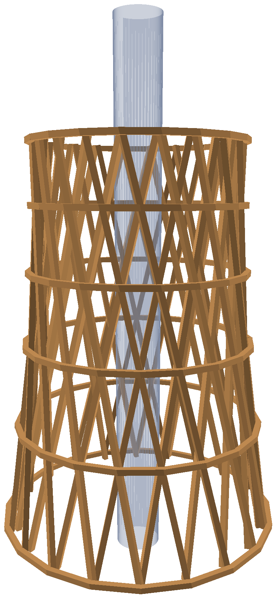

# Tower Designer

A Mac app that designs lightweight timber towers for load-test challenges, then gives you everything to build one: a 3D model for Onshape, 3D-printable assembly jigs, laser files and a full illustrated assembly guide.

The default brief is a tower that must:
- weigh ≤ 20 g, wood plus glue
- stand 211 mm tall
- slide over a 25 mm pole
- carry as much load as possible on a flat plate

It builds only from 3 × 3 mm sticks: every piece is one full-size stick, and only the joint ends are shaped. You can change all of these numbers in the app.



## What it does

- **Searches for a design.** It makes educated guesses for several tower types (stick lattices, twisted diagrids), then refines them with differential evolution, a brute-force sweep and a final polish.
- **Predicts strength.** It uses a 3D frame finite-element model with:
  - crushing, tension, bending and buckling checks on every piece
  - strength that depends on the grain angle (Hankinson)
  - geometric-stiffness buckling, with imperfections included
  - realism knock-downs for uneven bearing, a slightly crooked build and variable wood
- **Checks that everything fits.** Every export runs a fit check on the 3D model: each crossing, each ring end on its strip and each ring-to-ring joint must touch, and the jig must never overlap the tower. The results are printed in the guide.
- **Gives a tolerance for every cut.** The guide has a tolerance table, plus a tolerance for every row of the cut list. The jigs carry the matching allowances: strips cut 0.3 mm long for sanding, length ticks on the marking gauge, and slot clearances set from a fit-test coupon.
- **Picks the glue joint by joint.** Glue mass comes from the glue's viscosity and the glued area. Choices are balsa cement, PVA, superglue or 5-minute epoxy, and gluing can be kept symmetric round the tower.
- **Calibrates to your materials.** Printable wood and glue test kits measure your sticks and your gluing, and the app uses the results.
- **Exports a build pack.** It contains:
  - `tower.step` (one solid per stick) and `tower.stl`
  - every jig part as STL and STEP, each with an engraved ID: base plate, keyed mast, spacers with collar-support discs, numbered collar segments, cutting guide with stops, strip-end and ring-end sanding jigs, marking gauge and a fit-test coupon
  - a 3D model and picture of every build step
  - a long assembly guide PDF: cut list, grain, a glue map with colour codes, a print plan, step-by-step instructions with weigh-ins, and a section on fixing mistakes

## Reference tower

`examples/reference-tower/` holds the tower this app was built for. The app opens it by default.

| Design | 3 × 3 hyperboloid lattice, 20 straight strips twisting each way, Ø143 → Ø100 mm |
|---|---|
| Rings | base ring, a ring at every crossing level, top ring; half-lap joints (two pieces meet end to end on each strip) |
| Pieces | 160 pieces from 14 sticks, 320 balsa-cement joints |
| Predicted | 70.8 kg at 18.38 g (book balsa values) |
| Fit check | 0.00 mm gap at every crossing and ring joint; the jig never overlaps the tower |

Its full assembly guide is [`examples/reference-tower/Assembly guide.pdf`](examples/reference-tower/Assembly%20guide.pdf). The predicted load uses book values for medium balsa. Run the wood test before trusting it; real towers usually reach 50–100 % of the prediction.

## Install

### Option 1: the built app
Download `Tower.Designer-macOS.zip` from the [Releases](../../releases) page, unzip it and open **Tower Designer.app**.

The app isn't signed. The first time, right-click it, choose **Open**, then confirm. It's built for Apple silicon Macs.

The assembly-guide PDF is printed with Google Chrome. Without Chrome, the guide is still saved as `assembly_guide.html`.

### Option 2: from source
Needs Python 3.12 (`uv` recommended).

```bash
./setup.command                      # creates ~/.towerdesigner/venv and installs requirements.txt
open "Tower Designer.app"            # small launcher that runs the source in that environment
```

Or run it directly:

```bash
python -m towerdesigner                                        # window
python -m towerdesigner --cli --effort normal --out "My design"   # terminal search + export
```

The environment lives outside `~/Documents` on purpose: Qt can't load its plugins from iCloud-synced folders.

### Build the app yourself
```bash
PYTHON=~/.towerdesigner/venv/bin/python ./packaging/build_mac_app.sh
```
This produces `dist/Tower Designer.app`.

## Using it

1. **Before you print the rest of the jig:** print `fit_test_coupon.stl` first. Find the smallest slot a stick slides into with light friction, and set **Jig slot size** to that number.
2. **Do the wood test** (`test-kits/Wood test kit/`): weigh, crush and buckle a few sticks, then enter the results under **Wood and glue → Wood test…**.
3. **Optionally, do the glue test** (`test-kits/Glue test kit/`) so each glue's mass matches your gluing.
4. **Search for a design:** click **Design my tower**. Quick takes about 20 s, Normal 1–2 min, Thorough about 5 min.
5. **Fine-tune:** tweak any candidate in the **Edit** tab. **Fit widths to mass limit** brings a design back to the mass limit.
6. **Export the build pack** and follow the assembly guide.

## Project layout

```
towerdesigner/        the app (analysis, optimiser, CAD, jig, guide, GUI)
  examples/           reference_tower.json, opened by default
examples/             reference tower: design, pictures, assembly guide
test-kits/            printable wood and glue test kits
packaging/            PyInstaller build script
Tower Designer.app    launcher for running from source
setup.command         one-time environment setup
```

## Licence

GNU General Public License v3.0. See [LICENSE](LICENSE).

Tower Designer is free software: you can redistribute it and/or modify it under the terms of the GPL as published by the Free Software Foundation, version 3 or any later version. It comes with no warranty. Predicted loads are estimates; always test.
